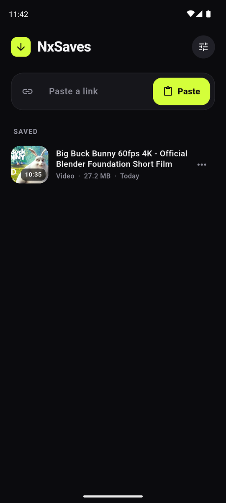
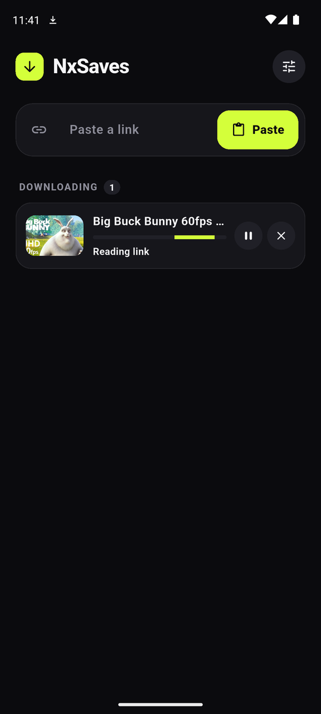

# NxSaves

A private video and audio downloader for Android and iPhone, built with Flutter. Paste or share a
link from YouTube, TikTok, Instagram, Facebook and most other video sites, pick a quality, and the
file lands in your gallery, your music app, or Photos and Files on iPhone.

For you and your friends only. **Not** for Google Play or the App Store.

<p>



</p>

## How it works

| | Android | iPhone |
|---|---|---|
| Where downloading happens | **On the phone** (the download engine, Python and ffmpeg are bundled in the app) | On **your NxSaves server** (`server/`), which sends the finished file to the phone |
| Needs a server | No | Yes |
| Engine updates | Automatic, once a day | Every time the server starts |
| Saved to | `Movies/NxSaves` and `Music/NxSaves` | Photos (videos) and Files › On My iPhone › NxSaves |

**Why the iPhone needs a server.** Merging video and audio needs ffmpeg as a separate program,
YouTube needs a JavaScript runtime, and sites change often enough that the engine needs updates
every few weeks. iOS doesn't let apps start helper programs, and App Store rules (guideline 2.5.2)
don't let an app download new code to update itself. A small server you control avoids all of that.

## Using the app

1. Copy a link, open NxSaves and tap **Paste**. On Android you can also tap **Share › NxSaves** in
   YouTube, TikTok, Instagram or a browser.
2. Pick **Video** or **Audio** and a quality, then tap **Download**. The quality you pick is offered
   first next time.
3. Progress shows under **Downloading**; finished files move to **Saved**. Tap a file to open it;
   the dots (or a long press) share it, copy its link or delete it.

**Settings** (top right): on iPhone, your server's address and token; on Android, optional sign-in
cookies for posts that need an account (a Netscape `cookies.txt` exported from a desktop browser,
for example with the "Get cookies.txt LOCALLY" extension). Cookies act as your logged-in account, so
keep the file private.

## Android: install the APK

Signed APKs are in `dist/` (build them yourself with `scripts\build_android.ps1`):

| File | For |
|---|---|
| `NxSaves-1.1.0-arm64-v8a.apk` | Almost every phone from the last ~8 years. **Send this one.** |
| `NxSaves-1.1.0-armeabi-v7a.apk` | Old 32-bit phones |
| `NxSaves-1.1.0-x86_64.apk` | Emulators, Chromebooks |
| `NxSaves-1.1.0-universal.apk` | Any device (larger) |

Send the APK (Google Drive, Telegram, USB…), open it on the phone and allow "Install unknown apps"
for the app you opened it from. Play Protect may warn about an app from an unknown developer; choose
*Install anyway*. Android 7.0 or newer is required. Version 1.1.0 installs over 1.0.0.

On first launch NxSaves unpacks its engine (a few seconds) and updates it. Allow notifications when
asked so you can see background progress.

**Updates:** raise `version:` in `pubspec.yaml`, build, and install over the old app. That only
works with the same signing key, so **back up `android/keystore/` and `android/key.properties`**.

## The NxSaves server (needed for iPhone)

Run it on a computer that stays on (your PC, a Mac, a Raspberry Pi, a NAS or a VPS).

**Requirements:** Python 3.10+, [ffmpeg](https://ffmpeg.org/download.html), and a JavaScript runtime:
[Deno](https://deno.com) (recommended) or Node.js 20+.

```powershell
# Windows (ffmpeg: winget install Gyan.FFmpeg · Deno: winget install DenoLand.Deno)
powershell -ExecutionPolicy Bypass -File server\start_server.ps1
```

```bash
# macOS / Linux
sh server/start_server.sh
```

```bash
# Docker (bundles ffmpeg + Deno)
docker build -t nxsaves-server server/
docker run -d --name nxsaves -p 8765:8765 -v nxsaves-data:/data --restart unless-stopped nxsaves-server
docker logs nxsaves   # shows the token
```

On startup it prints its addresses and an **access token** (kept in `server/data/token.txt`; set
`NXSAVES_TOKEN` to choose your own, shorter one). In the app open **Settings**, enter the address
(e.g. `http://192.168.1.20:8765`) and the token, and tap **Connect**. On Windows, allow Python
through the firewall for private networks when asked.

Options (environment variables): `NXSAVES_TOKEN`, `NXSAVES_DATA`, `NXSAVES_WORKERS` (parallel
downloads, default 2), `NXSAVES_JOB_TTL_HOURS` (finished files are deleted after this, default 6),
`NXSAVES_COOKIES` (path to a cookies.txt), `NXSAVES_FFMPEG`.

### Reaching the server away from home

* **Same Wi-Fi only:** use the computer's LAN address.
* **[Tailscale](https://tailscale.com) (recommended, free):** install it on the server and on each
  phone, share the machine with friends from the Tailscale admin console, and use the server's
  Tailscale IP, e.g. `http://100.101.102.103:8765`. Nothing is exposed to the internet.
* **[Cloudflare Tunnel](https://developers.cloudflare.com/cloudflare-one/connections/connect-networks/):**
  `cloudflared tunnel --url http://localhost:8765` gives a public `https://….trycloudflare.com`
  address (it changes every run; a named tunnel keeps it). Anyone with the address still needs the token.

A home connection works much better than a VPS: YouTube often blocks data-center IPs.

## iPhone: TestFlight through Codemagic

iOS apps can only be built on a Mac, so this uses Codemagic's cloud Macs (`codemagic.yaml`) with the
same Apple developer account, App Store Connect API key (`codemagic_asc_key`) and distribution
certificate as the Gallery app. Builds are **internal testing only**: they go to people on your App
Store Connect team with no App Review, and can never reach external testing or the App Store.

One-time setup:

1. **Bundle ID.** [developer.apple.com](https://developer.apple.com/account/resources/identifiers/list)
   → Identifiers → **+** → App IDs → App. Description `NxSaves`, Bundle ID (Explicit)
   `com.nxsaves.app`, no capabilities → Register.
2. **Profile.** Profiles → **+** → *App Store Connect* → App ID `com.nxsaves.app` → the
   distribution certificate Codemagic already has → name `NxSaves App Store` → Generate.
3. **App record.** [App Store Connect](https://appstoreconnect.apple.com) → Apps → **+** → New App:
   iOS, name `NxSaves` (if it's taken, e.g. `NxSaves Downloader`), bundle ID `com.nxsaves.app`,
   SKU `nxsaves`, Full Access → Create.
4. **Codemagic signing.** Team settings → codemagic.yaml settings → Code signing identities → iOS
   provisioning profiles → *Fetch from Developer Portal* → `NxSaves App Store` → Add.
5. **Repository.** Push this folder to a private GitHub repository, then in Codemagic: Add
   application → GitHub → that repository → codemagic.yaml.
6. **Build.** Start new build → branch `main` → workflow **iOS to TestFlight** (about 15 minutes).
   To build on every push, add Codemagic's webhook to the repository as described in the Gallery
   app's README.
7. **Testers.** App Store Connect → the app → TestFlight → Internal Testing → add a group with you
   and your friends (each must be a user on your App Store Connect team; the *Customer Support* role
   is enough). They install **TestFlight**, accept the invite and install NxSaves.

On the iPhone, open NxSaves → Settings, enter the server address and token, and tap **Connect**.
Videos go to Photos and to Files › On My iPhone › NxSaves; audio goes to Files. iOS pauses apps in
the background: the server keeps downloading, and the transfer to the phone resumes when you reopen
the app. TestFlight builds expire after 90 days, so build again before then.

## Building from source

Requirements: Flutter 3.47 (stable), Android SDK with build-tools and NDK 28 (installed by Android
Studio), JDK 17+.

```powershell
flutter pub get
flutter test                                                         # unit tests
flutter run                                                          # debug on a device/emulator
powershell -ExecutionPolicy Bypass -File scripts\build_android.ps1   # signed release APKs → dist\
```

```
lib/src/core/      models, quality options, engine arguments, progress & error parsing (unit-tested)
lib/src/engine/    LocalEngine (Android, platform channel) and RemoteEngine (server HTTP client)
lib/src/services/  download queue, library, settings, Android platform bridge
lib/src/ui/        home screen, link sheet, settings; colors in theme.dart
android/app/src/main/kotlin/com/nxsaves/app/
                   engine bridge, MediaSaver (MediaStore), DownloadService (foreground service),
                   PlatformBridge (share intents, permissions, cookies)
server/            nxsaves_server.py (FastAPI), start scripts, Dockerfile
scripts/           create_keystore.ps1, build_android.ps1
```

The format/sort options are defined twice and must stay in sync: `lib/src/core/ytdlp_args.dart`
(phone) and `server/nxsaves_server.py` (server). The server only accepts this high-level spec,
never raw engine arguments from clients.

Windows: Gradle fails with `Unable to establish loopback connection` when the temp path has spaces.
`scripts\build_android.ps1` works around it; for manual builds run
`set JAVA_TOOL_OPTIONS=-Djdk.net.unixdomain.tmpdir=C:/jdktmp` (create `C:\jdktmp`) first.

## Troubleshooting

| Problem | Fix |
|---|---|
| "YouTube wants to confirm you're not a bot" | Wait a while and retry, or add sign-in cookies. Avoid data-center servers. |
| "This post needs a logged-in account" (Instagram, Facebook) | Add sign-in cookies (Android: Settings; server: `NXSAVES_COOKIES`). |
| A site suddenly stopped working | The engine updates itself daily on Android and on every server restart. |
| "Can't reach your NxSaves server" | Check the address (with `http://` and the port), that the server is running, the firewall, and Tailscale. |
| TikTok fails on the server | `pip install -U -r server/requirements.txt` (it needs `curl_cffi`). |
| Android 9 or older can't save | Allow the storage permission when asked. |

## Legal

Only download content you own, that is licensed for reuse (e.g. Creative Commons), or that you
have permission to save. Respect copyright and each site's terms of service. NxSaves doesn't
circumvent DRM. The Android app bundles GPL-3.0 code (youtubedl-android) and LGPL/GPL code (ffmpeg),
so give anyone you send the APK the source too (this folder) if they ask. Keep distribution private.
