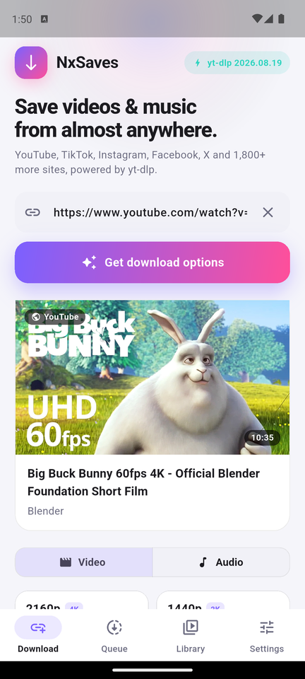
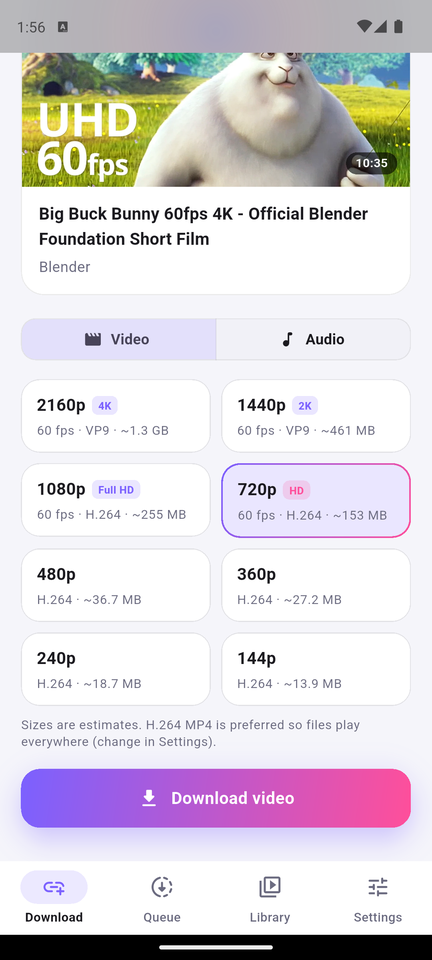
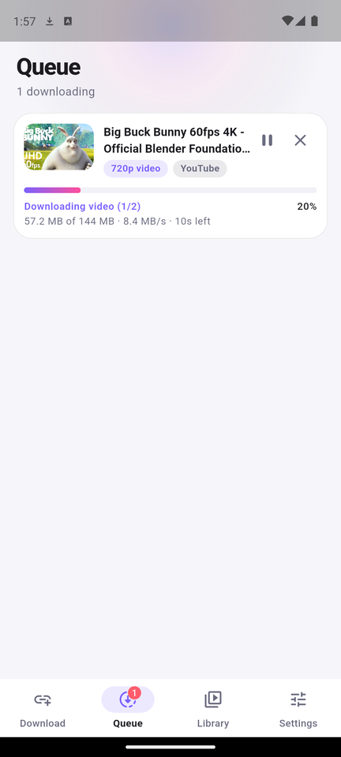
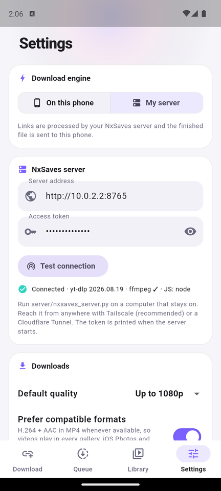

# NxSaves

A private video & audio downloader for Android and iOS, built with Flutter and powered by
[yt-dlp](https://github.com/yt-dlp/yt-dlp). Paste or share a link from YouTube, TikTok, Instagram,
Facebook, or any of the 1,800+ sites yt-dlp supports, pick a quality, and the file lands in your
gallery, music app or the iOS Files app.

For personal use by you and your friends only. **Not** for Google Play or the App Store.

<p>




</p>

## How it works

| | Android | iOS |
|---|---|---|
| Where yt-dlp runs | **On the phone**, via [youtubedl-android](https://github.com/yausername/youtubedl-android) (Python 3.12, yt-dlp, ffmpeg, QuickJS bundled) | On **your NxSaves server** (`server/`), which sends the finished file to the phone |
| Needs a server | No (it can optionally use one) | Yes |
| yt-dlp updates | Automatic, inside the app (daily) | Updated every time the server starts |
| Saved to | `Movies/NxSaves` and `Music/NxSaves` (gallery, music apps) | Files › On My iPhone › NxSaves, and videos added to Photos |

**Why iOS needs a server.** yt-dlp is a Python program that starts **ffmpeg** to merge
video and audio. YouTube now also requires a **JavaScript runtime** (Deno/Node/QuickJS) to solve
its signature challenges, and sites change often enough that yt-dlp ships fixes every few weeks.
iOS doesn't allow apps to start helper processes, and App Store rules (guideline 2.5.2) don't let an
app download new code to update itself. A frozen, ffmpeg-less yt-dlp inside the iPhone app would
be limited to low-quality single-file downloads and would break within weeks. A small server you
control avoids all of that.

## Features

* Paste a link, or on Android **Share → NxSaves** from YouTube, TikTok, Instagram, a browser…
* Shows only the qualities the link really has (4K … 144p, fps, codec, estimated size), plus **MP3** or
  original **M4A** audio with cover art and title/artist tags.
* "Prefer compatible formats" (default on) picks H.264 + AAC MP4 whenever available, so files play
  everywhere (iOS Photos, WhatsApp, every gallery). Turn it off for VP9/AV1.
* Queue with up to 3 simultaneous downloads, live progress/speed/ETA, pause & resume (on-device
  downloads resume from the partial file), cancel, retry, and error details.
* Android: downloads keep running in the background (foreground-service notification), even after
  the app is swiped away; interrupted downloads resume when the app restarts.
* Playlists and profiles: every item is added to the queue with the quality you pick.
* Library: open, share, save to Photos (iOS), copy the original link, delete. Thumbnails are cached
  locally, and files deleted outside the app are flagged.
* Optional `cookies.txt` for posts that need a logged-in account (Instagram, Facebook, age-restricted
  YouTube).
* Light/dark theme, animated UI.

---

## 1. Android: install the APK

Ready-made, signed APKs are in `dist/` (build them yourself with `scripts\build_android.ps1`):

| File | For |
|---|---|
| `NxSaves-1.0.0-arm64-v8a.apk` | Almost every phone from the last ~8 years. **Send this one.** |
| `NxSaves-1.0.0-armeabi-v7a.apk` | Old 32-bit phones |
| `NxSaves-1.0.0-x86_64.apk` | Emulators, Chromebooks |
| `NxSaves-1.0.0-universal.apk` | Any device (larger) |

Send the APK (Google Drive, Telegram, USB…), open it on the phone and allow "Install unknown apps"
for the app you opened it from. Play Protect may warn about an app from an unknown developer; choose
*Install anyway*. Android 7.0 (API 24) or newer is required. All variants share one version code,
so a phone can move between them when updating.

On first launch NxSaves unpacks its engine (a few seconds) and updates yt-dlp. Allow notifications
when asked so you can see background progress.

**Updates:** build a new APK with a higher `version:` in `pubspec.yaml` and install it over the old
one. That only works if it is signed with the same key, so **back up `android/keystore/` and
`android/key.properties`**. Without them, friends have to uninstall first.

## 2. The NxSaves server (needed for iPhone, optional for Android)

Run it on a computer that stays on (your PC, a Mac, a Raspberry Pi, a NAS or a VPS).

**Requirements:** Python 3.10+, [ffmpeg](https://ffmpeg.org/download.html), and a JavaScript runtime:
[Deno](https://deno.com) (recommended) or Node.js 20+. TikTok also needs `curl_cffi`, which
`requirements.txt` installs.

```powershell
# Windows (ffmpeg: winget install Gyan.FFmpeg · Deno: winget install DenoLand.Deno)
powershell -ExecutionPolicy Bypass -File server\start_server.ps1
```

```bash
# macOS / Linux
sh server/start_server.sh
```

```bash
# Docker (bundles ffmpeg + Deno)
docker build -t nxsaves-server server/
docker run -d --name nxsaves -p 8765:8765 -v nxsaves-data:/data --restart unless-stopped nxsaves-server
docker logs nxsaves   # shows the token
```

On startup it prints its addresses and an **access token** (generated once and kept in
`server/data/token.txt`; set `NXSAVES_TOKEN` to choose your own). In the app go to
**Settings → NxSaves server**, enter the address (e.g. `http://192.168.1.20:8765`) and the token,
then tap **Test connection**. On Windows, allow Python through the firewall for private networks
when asked.

Options (environment variables): `NXSAVES_TOKEN`, `NXSAVES_DATA`, `NXSAVES_WORKERS` (parallel
downloads, default 2), `NXSAVES_JOB_TTL_HOURS` (finished files are deleted after this, default 6),
`NXSAVES_COOKIES` (path to a cookies.txt), `NXSAVES_FFMPEG`.

### Reaching the server from anywhere

* **Same Wi-Fi only:** use the computer's LAN address.
* **[Tailscale](https://tailscale.com) (recommended, free):** install it on the server and on each
  phone. To give friends access, share the machine with them from the Tailscale admin console.
  Use the server's Tailscale IP, e.g. `http://100.101.102.103:8765`. Traffic is encrypted and the
  server is not exposed to the internet.
* **[Cloudflare Tunnel](https://developers.cloudflare.com/cloudflare-one/connections/connect-networks/):**
  `cloudflared tunnel --url http://localhost:8765` gives you a public `https://….trycloudflare.com`
  address (it changes every run; set up a named tunnel for a permanent one). Anyone with the address
  still needs the token.

Downloading from a home connection works much better than from a VPS: YouTube often blocks data
center IPs ("Sign in to confirm you're not a bot").

## 3. iOS: TestFlight (private)

TestFlight's **internal testing** is the private channel: up to 100 people who are members of your
App Store Connect team, with **no App Review**. Builds expire after 90 days, so upload a fresh build
before then. Don't use *external* testing or App Store submission: those go through review, and
downloader apps are rejected under guideline 5.2.3.

One-time setup in [App Store Connect](https://appstoreconnect.apple.com):

1. **My Apps → + → New App**: platform iOS, name NxSaves, bundle ID `com.nxsaves.app` (register it
   under *Certificates, Identifiers & Profiles → Identifiers* first if it isn't offered). If the ID is
   taken, use your own (e.g. `com.yourname.nxsaves`) and change `PRODUCT_BUNDLE_IDENTIFIER` in
   `ios/Runner.xcodeproj/project.pbxproj`.
2. **Users and Access**: invite each friend (the *Customer Support* role is enough). They accept with
   an Apple ID.
3. **TestFlight → Internal Testing**: create a group, add yourself and your friends, and enable
   automatic distribution of new builds.

### Option A: build on a Mac

Requires Xcode 16+, [Flutter 3.47](https://docs.flutter.dev/get-started/install/macos) and
CocoaPods (`brew install cocoapods`).

```bash
flutter pub get
open ios/Runner.xcworkspace   # Runner target → Signing & Capabilities → choose your Team (once)
flutter build ipa --release
```

Then upload `build/ios/ipa/NxSaves.ipa` with Apple's **Transporter** app (or Xcode → Organizer →
Distribute App → TestFlight Internal Only). Alternatively, set your Team ID in
`ios/ExportOptions.plist` and run `flutter build ipa --release --export-options-plist=ios/ExportOptions.plist`
to build and upload in one step.

### Option B: no Mac (GitHub Actions)

Push the project to a **private** GitHub repository. First run **Actions → iOS check → Run
workflow**: it needs no secrets, compiles the iOS release build, and runs an end-to-end test on the
iOS simulator against a server started on the runner (screenshots are attached to the run). Then
add the secrets listed at the top of
`.github/workflows/ios-testflight.yml` (Team ID plus an App Store Connect API key with the Admin
role), then open **Actions → iOS TestFlight → Run workflow**. It builds on a macOS runner, signs with
Xcode's automatic (cloud) signing, and uploads straight to TestFlight as internal-only. macOS runner
minutes count 10× against the free quota of private repos (a build takes roughly 10–20 minutes).

### On the iPhone

Friends install **TestFlight** from the App Store, accept the invite and install NxSaves. In
**Settings → NxSaves server**, enter the server address and token. Downloads appear in the Files
app under *On My iPhone › NxSaves*, and videos are also added to Photos (you can turn that off). iOS
pauses apps in the background: the server keeps downloading, and the transfer to the phone resumes
where it left off when you reopen the app.

---

## Using the app

1. Copy a link (or on Android, tap **Share → NxSaves** in the other app).
2. Tap **Paste**, then **Get download options**.
3. Pick **Video** or **Audio** and a quality, then tap **Download**.
4. Watch it in **Queue**; find it in **Library**, your gallery or Files.

**Cookies (optional):** for content that needs a login, export cookies for that site from a desktop
browser in Netscape `cookies.txt` format (for example with the "Get cookies.txt LOCALLY"
extension), copy the file to the phone and use **Settings → Cookies → Import** (on-device engine),
or set `NXSAVES_COOKIES` on the server. Cookies act as your logged-in account, so keep the file
private.

## Building from source

Requirements: Flutter 3.47 (stable), Android SDK with build-tools and NDK 28 (installed by
Android Studio), JDK 17+.

```powershell
flutter pub get
flutter test                                                   # unit tests
flutter run                                                    # debug on a device/emulator
powershell -ExecutionPolicy Bypass -File scripts\build_android.ps1   # signed release APKs → dist\
```

Server tests: start the server and check `GET /api/health` with `Authorization: Bearer <token>`.

### Project layout

```
lib/src/core/      models, quality options, yt-dlp arguments, progress & error parsing (unit-tested)
lib/src/engine/    LocalEngine (Android, platform channel) and RemoteEngine (server HTTP client)
lib/src/services/  download queue, library, settings, Android platform bridge
lib/src/ui/        Download, Queue, Library, Settings screens
android/app/src/main/kotlin/com/nxsaves/app/
                   YtDlpBridge (runs yt-dlp), MediaSaver (MediaStore), DownloadService
                   (foreground service), PlatformBridge (share intents, permissions, cookies)
server/            nxsaves_server.py (FastAPI + yt-dlp), start scripts, Dockerfile
scripts/           create_keystore.ps1, build_android.ps1
```

The yt-dlp format/sort options are defined twice and must stay in sync: `lib/src/core/ytdlp_args.dart`
(phone) and `server/nxsaves_server.py` (server). The server only accepts this high-level spec,
never raw yt-dlp arguments from clients.

## Troubleshooting

| Problem | Fix |
|---|---|
| Gradle: `Unable to establish loopback connection` (Windows) | A JDK bug with temp paths that contain spaces. `scripts\build_android.ps1` works around it; for manual builds run `set JAVA_TOOL_OPTIONS=-Djdk.net.unixdomain.tmpdir=C:/jdktmp` (create `C:\jdktmp`) first. |
| "Sign in to confirm you're not a bot" | Update yt-dlp (Settings → Update, try the Nightly channel), wait a while, or add cookies. Avoid data-center servers. |
| Instagram/Facebook: "requires a logged-in account" | Add a cookies.txt (see above). |
| TikTok fails on the server | Make sure `curl_cffi` is installed: `pip install -U "yt-dlp[default,curl-cffi]"`. |
| A site suddenly stopped working | Update yt-dlp: it's automatic on Android (daily) and happens on every server restart. |
| "Can't reach your NxSaves server" | Check the address (include `http://` and the port), that the server is running, the firewall, and Tailscale. |
| iOS: "Photos does not support this video format" | That quality is VP9/AV1. Keep "Prefer compatible formats" on, or pick a quality marked H.264. The file is still in Files. |
| Android 9 or older can't save | Allow the storage permission when asked. |

## What has been tested

On an Android 14 emulator (Pixel 8, x86_64), with both the debug build and the signed release APK,
plus the server on Windows 11 (Python 3.11, ffmpeg 7.1, Node 22):

* On the phone: first-launch engine unpack and automatic yt-dlp update (2025.11.12 → 2026.08.19);
  link via the Android share intent; YouTube info and quality list; 144p and 720p H.264 MP4 (merged,
  verified with ffprobe); MP3 with cover art and tags; pause → resume from the partial file;
  background download with progress notification; downloads continuing after the app is swiped
  away; resuming after the app is force-stopped; an 11-item playlist downloading 2 at a time;
  saving to `Movies/NxSaves` and `Music/NxSaves`; opening in Google Photos; delete; cookies.txt
  import; error messages and details; TikTok, Instagram and Facebook extraction, and a TikTok
  download.
* Server mode (the same code path the iPhone app uses), from the app: Test connection, info,
  download with server progress, transfer to the phone and saving. Via the API: cancel, HTTP Range
  resume (206), token check (401), URL validation, and TikTok, Instagram, Facebook and SoundCloud
  extraction.
* 23 Dart unit tests (`flutter test`) cover quality selection against real yt-dlp output, argument
  building, progress parsing, error mapping, link extraction and persistence.

**Not tested here:** the iOS build itself, since that needs a Mac with Xcode. The iOS app is the
same Dart code (`flutter analyze` is clean) using standard plugins (path_provider, share_plus, gal,
open_filex), and its download path (the server engine) was exercised on Android, but iOS-only
parts (saving to Files/Photos, the share sheet, TestFlight signing) have not run. The GitHub
Actions workflow and the Dockerfile were written but not run. No physical Android phone was
available; the arm64 APK is built from the same sources as the tested x86_64 one. The separate
saving path for Android 9 and older (storage permission + MediaScanner) was not run either; only
Android 14 was tested.

## Legal

Only download content you own, that is licensed for reuse (e.g. Creative Commons), or that you
have permission to save. Respect copyright and each site's terms of service. NxSaves doesn't
circumvent DRM. yt-dlp is released under the Unlicense, ffmpeg under the LGPL/GPL, and
youtubedl-android under GPL-3.0. Because the Android app bundles GPL-3.0 code, give
anyone you send the APK the source too (this folder) if they ask. Keep distribution private.
